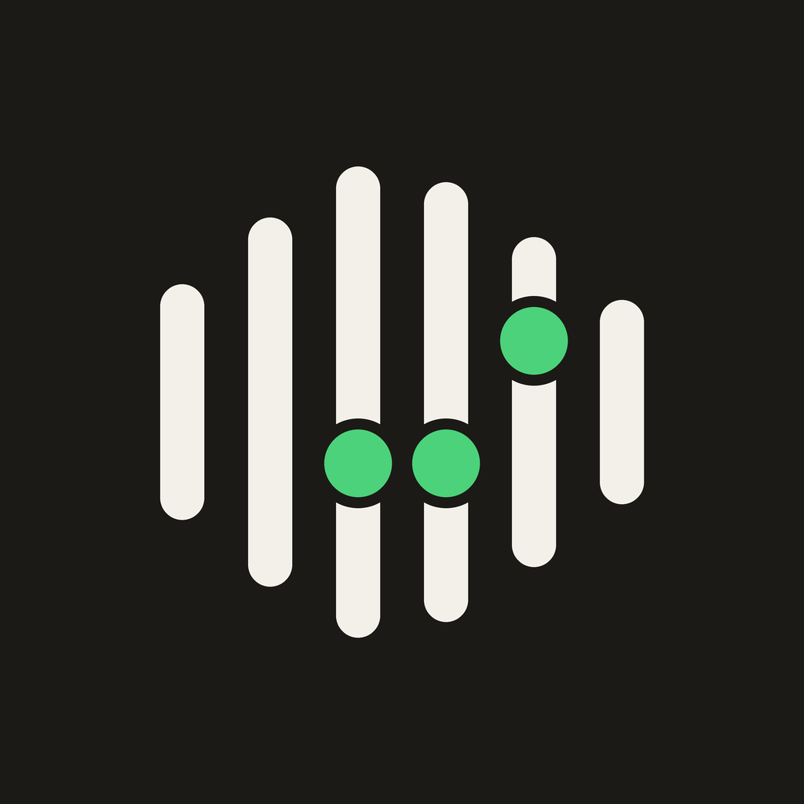
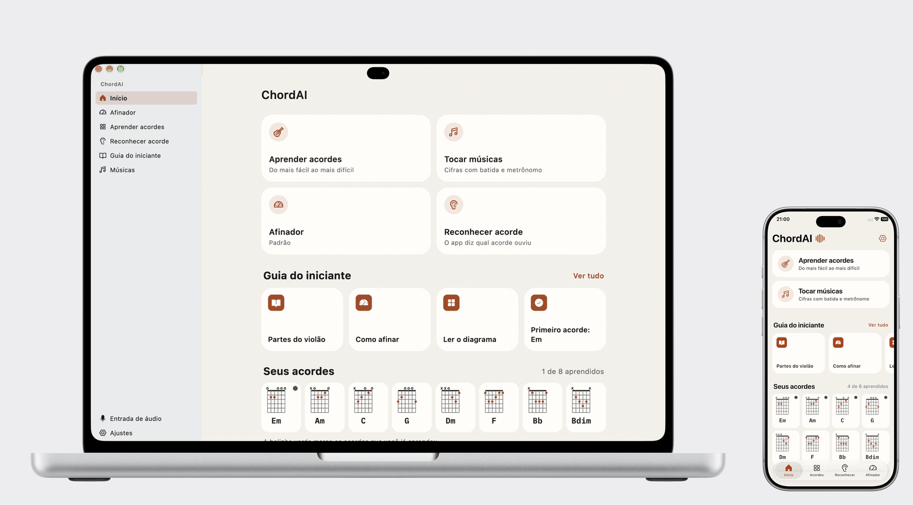
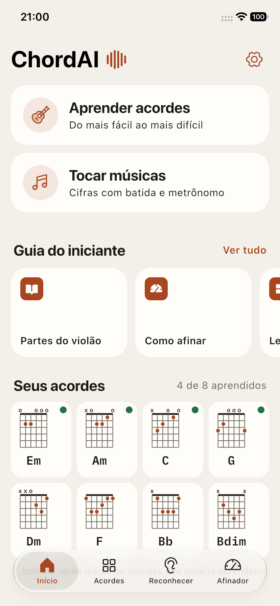
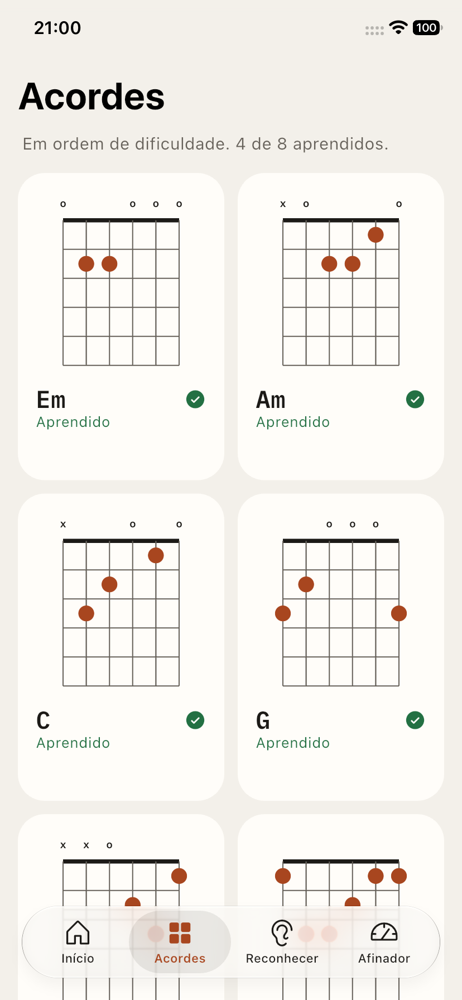
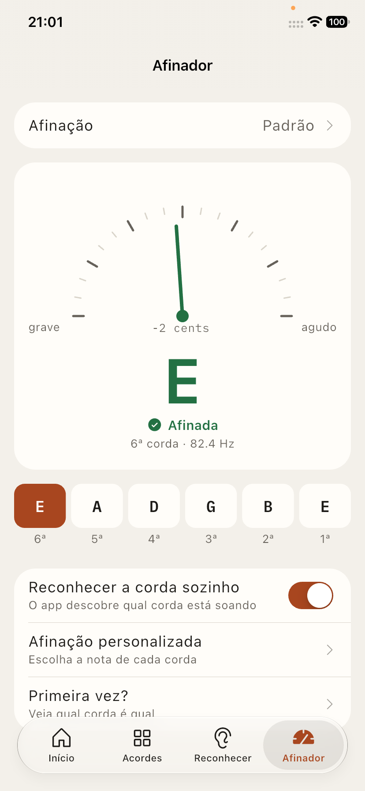

<p align="center">
  
</p>

<h1 align="center">ChordAI</h1>

[](https://github.com/imxder/ChordAI/actions/workflows/ci.yml) [](https://sonarcloud.io/summary/new_code?id=imxder_ChordAI) [](https://sonarcloud.io/component_measures?id=imxder_ChordAI&metric=coverage) [](https://github.com/imxder/ChordAI/releases/latest)



O ChordAI é um app para quem está começando no violão, feito como TCC de Engenharia de Software. A pessoa toca um acorde, o app escuta e diz se saiu certo. Ele também tem afinador, cifras para tocar junto com a música e um guia para iniciantes.

O app é feito em Flutter e roda no iPhone, no Android, no Windows e no Mac. O modelo que reconhece os acordes é treinado no [ChordAI-backend](https://github.com/imxder/ChordAI-backend).

## Telas

| Início | Acordes | Reconhecer | Afinador | Tocar junto |
|---|---|---|---|---|
|  |  |  |  |  |

## Funcionalidades

- **Reconhecer acorde**: mostra em tempo real o acorde que o app está ouvindo. É a função principal. O treino de acorde, as sequências e o tocar junto usam a mesma leitura.
- **Acordes**: diagrama de cada acorde no braço do violão e o "Tocar e testar", que escuta o acorde tocado e marca o acorde como aprendido depois de 3 acertos seguidos. Cada acerto precisa de uma batida nova: deixar o acorde soando conta uma vez só. Quando o acorde vira aprendido, o app toca um som e o botão leva para a lista de acordes.
- **Afinador**: detecta a nota de cada corda com o algoritmo YIN, com ponteiro estável, aviso de "afinada" e afinações alternativas (Drop D, meio tom abaixo, Open G, Open D, DADGAD) ou personalizadas.
- **Sequências**: treino de progressões de acordes com metrônomo.
- **Tocar junto**: cifras só com os acordes (o desenho de cada um e as setas da batida) que avançam no andamento da música ou esperam a troca de acorde, com andamento ajustável e um resumo no fim com os acordes mais errados. Dá para desligar o microfone e tocar só com o metrônomo. O modelo decide em janelas de 1,5 s, então acorde que dura menos de 1 s não conta.
- **Minhas músicas**: dá para montar uma música no próprio app, com as partes, os acordes, o andamento e a batida. Ela fica só no aparelho.
- **Guia do iniciante**: 12 tópicos para quem nunca tocou, das partes do violão e como afinar até ler o diagrama, ler uma cifra, a batida, trocar de acorde e cuidar do violão. As fontes estão em [docs/guia_fontes.md](docs/guia_fontes.md).
- **Sons**: clique do metrônomo, som de acorde aprendido e de corda afinada ([docs/sons.md](docs/sons.md)). Dá para desligar.
- **Ajustes** (Configurações no Android e no Windows): aparência (papel, branco, escuro ou igual ao celular), cor do app, afinação, leitura das cifras, sons, reconhecimento e privacidade. No celular, abre pela engrenagem no canto da tela inicial. Os acordes aprendidos aparecem na tela inicial, em "Seus acordes".

No celular, as abas de baixo são Início, Acordes, Reconhecer e Afinador, e as músicas abrem pelo card "Tocar músicas". No Windows e no Mac, as mesmas telas ficam numa barra lateral ([docs/desktop.md](docs/desktop.md)).

## Plataformas e como instalar


| Plataforma | Como instalar |
|---|---|
| **Android** | Baixe o `ChordAI.apk` pela [página Baixar da Wiki](https://github.com/imxder/ChordAI/wiki/Baixar) ou direto em [`releases/latest/download/ChordAI.apk`](https://github.com/imxder/ChordAI/releases/latest/download/ChordAI.apk). O Android pede para permitir apps desconhecidos, e o Play Protect pode avisar: o passo a passo está na Wiki. Precisa de Android 7.0 ou mais novo (página Baixar). O QR Code do pôster aponta para essa página. |
| **Windows** | Baixe o [`ChordAI-windows.zip`](https://github.com/imxder/ChordAI/releases/latest/download/ChordAI-windows.zip), extraia a pasta `ChordAI` e abra o `chordai.exe`. Como o app não é assinado, o SmartScreen avisa: a janela diz *O Windows protegeu o computador* e *O Microsoft defender SmartScreen impediu que um aplicativo não reconhecido fosse iniciado*. Clique em **Mais informações**: aparecem o aplicativo (`chordai.exe`) e o fornecedor ("Fornecedor desconhecido"). Aí clique em **Executar assim mesmo**. |
| **Mac** | Baixe o [`ChordAI-macos.zip`](https://github.com/imxder/ChordAI/releases/latest/download/ChordAI-macos.zip) e arraste o `ChordAI.app` para a pasta Aplicativos. O app é universal (Apple Silicon e Intel), pede macOS 12 ou mais novo e tem só a assinatura ad-hoc (`.github/workflows/release.yml`), sem conta paga da Apple. Na primeira vez, o Gatekeeper não deixa abrir e avisa que não consegue verificar o app. Os nomes abaixo são os de um macOS em inglês: a janela diz *"ChordAI" Not Opened* e *Apple could not verify "ChordAI" is free of malware that may harm your Mac or compromise your privacy*. Clique em **Done**, abra Ajustes do Sistema → Privacidade e Segurança (*Privacy & Security*) e role até *Security*. Ao lado de *"ChordAI" was blocked to protect your Mac*, clique em **Open Anyway**. Na janela *Open "ChordAI"?*, clique de novo em **Open Anyway**. |
| **iPhone** | Não tem pacote para baixar. Instale pelo Mac, com o cabo, em modo release (veja "Como rodar"). Pede iOS 15 ou mais novo. |

## Como rodar

Requisitos: Flutter 3.47 (Dart 3.13) e, para iOS, Xcode com CocoaPods.

```bash
flutter pub get
flutter run
```

Para instalar no iPhone em modo release, com o iPhone no cabo ou na mesma rede:

```bash
flutter run --release -d <id-do-iphone>
```

O `flutter devices` mostra o id. Não use o `flutter install`: ele desinstala o app antes de instalar de novo, e isso apaga os acordes aprendidos, as preferências e as músicas.

No Mac e no Windows: `flutter run --release -d macos` e `flutter run --release -d windows`.

## Como o reconhecimento funciona

O modelo escolhido roda dentro do aparelho, em TensorFlow Lite, sem internet nem computador. O app não pede permissão de internet e o som não sai do aparelho ([ADR 0001](docs/adr/0001-inferencia-no-aparelho.md) e [ADR 0003](docs/adr/0003-sem-modo-servidor.md)).

1. O microfone grava 22.050 Hz, mono, e o app guarda sempre os últimos 1,5 s (33.075 amostras).
2. A cada 0,5 s, se não for silêncio, essa janela vai para o modelo, fora da thread da interface. A chroma (quanto de cada nota há na janela) está dentro do modelo, então o app só manda o áudio bruto.
3. O modelo devolve uma probabilidade por acorde, mais a classe "nenhum acorde". Abaixo do limiar de confiança do modelo, o app diz "não reconheci" em vez de chutar.
4. Um acorde só aparece na tela quando sai igual em pelo menos 2 das últimas 3 leituras, e no máximo uma vez a cada 1,5 s.
5. Os dois modelos vêm das releases do backend, e o `model_info.json` de cada pasta guarda o limiar e o hash do `.tflite`.

O caminho completo, com o arquivo e o teste de cada passo, o afinador, o tocar junto e o que fica salvo no aparelho estão em [docs/como-funciona.md](docs/como-funciona.md).

O app traz dois modelos, e a escolha fica em **Ajustes → Reconhecimento → Modelo no aparelho**:

| Modelo | Na tela | Acordes | Limiar | Pasta |
|---|---|---|---|---|
| **v3** (padrão) | "Só v3" | 8: Am, Bb, Bdim, C, Dm, Em, F e G | 0,50 | `assets/models/v3/` |
| **v3_meu** | "v3 + meu dataset" | 9: os 8 + A | 0,55 | `assets/models/v3_meu/` |

Fonte do limiar e dos acordes: o `model_info.json` e o `labels.json` de cada pasta.

**Os números.** Cada linha vem de um teste diferente:

| Teste | v3 | v3_meu |
|---|---:|---:|
| Acerto no **Test do V3**: 1508 janelas de 10 pessoas e violões que não aparecem no treino | **87,4%** | 85,7% |
| Falso aceite com **sem acorde gravado**: 48 janelas de cordas abafadas e afinando (quanto menor, melhor) | 81,2% | **22,9%** |

Fonte: [`experiments/results_duas_fontes/comparativo.md`](https://github.com/imxder/ChordAI-backend/blob/main/experiments/results_duas_fontes/comparativo.md), no backend. O acerto é sem limiar e só nos 8 acordes do v3. O v3 é o padrão porque acertou mais com pessoas e violões que ele nunca ouviu. O v3_meu reconhece o Lá maior e mostra bem menos acorde quando não tem acorde sendo tocado. O teste de sem acorde é pequeno, e as limitações estão no [ADR 0002](docs/adr/0002-dois-modelos-no-app.md). O A só aparece no app quando o v3_meu está escolhido.

O tempo de cada leitura no celular e a demora entre tocar o acorde e ele aparecer na tela ainda não foram medidos. O método está em [docs/como-funciona.md](docs/como-funciona.md), seção 7, como trabalho futuro. No computador de desenvolvimento, o `.tflite` leva 8,78 ms por janela com 1 thread (`export_report.json` do backend).

A API Flask do [ChordAI-backend](https://github.com/imxder/ChordAI-backend) continua lá, mas só como ferramenta para testar um modelo pelo computador. Ela usa outro modelo (`trained_model/`) e o app não fala com ela.

## Testes

```bash
flutter analyze
flutter test                                           # todos
flutter test test/pitch_smoother_test.dart             # um arquivo só
```

São **571 testes** em `test/` (`flutter test`, 23/11/2026, num Mac): **561 passam e 10 são pulados** de propósito (o `imagens_docs_test.dart`, que só roda num Windows). Mais **2** em `integration_test/`, que precisam de um aparelho.

| Área | Testes |
|---|---:|
| Reconhecimento e modelo (`chord_stabilizer_test`, `on_device_model_test`, `chord_for_model_test`, `microfone_desktop_test`) | 57 |
| Regras da prática: treino do acorde e tocar junto (`chord_repeat_gate_test`, `tocar_junto_test`, `musicas_test`) | 60 |
| Afinador (`pitch_detector_test`, `pitch_smoother_test`, `recorded_strings_test`) | 47 |
| Músicas e cifras (`minhas_musicas_test`, `chord_sequence_test`, `chord_beats_test`) | 41 |
| Telas, abas e as quatro plataformas (`layout_sizes_test`, `desktop_test`, `guia_test`, `theme_contrast_test`) | 337 |
| Privacidade, sons e segundo plano (`sons_test`, `segundo_plano_test`, `privacy_policy_test`) | 29 |
| **Total** | **571** |

A lista de cada arquivo, o que ele garante e como contei está em [docs/testes.md](docs/testes.md).

**Por que o teste de equivalência roda no aparelho e não no computador.** Ele carrega o `.tflite` pela biblioteca nativa do TensorFlow Lite, e o `flutter test` comum roda na máquina de desenvolvimento, sem essa biblioteca. No celular, no simulador ou no Windows e no Mac (com as bibliotecas de `blobs/`), ela existe, e é onde o app de verdade roda o modelo.

```bash
flutter test integration_test/chord_model_equivalence_test.dart -d <id-do-aparelho>
```

Para conferir se os `.tflite` em `assets/models/` são os das releases do backend, sem trocar nenhum arquivo por engano:

```bash
python3 tool/conferir_modelos.py
```

O script calcula o sha256 de cada `chord_model.tflite` e compara com o campo `sha256` do `model_info.json` da mesma pasta. Se algum não bater, ele sai com erro. O CI roda esse script em todo push.

## Qualidade

- **CI** (`.github/workflows/ci.yml`): em todo push e PR, confere a formatação, roda o `flutter analyze` e o `flutter test`, confere o hash dos modelos e compila o APK e o app do Mac.
- **SonarCloud**: análise e cobertura dos testes, com o Quality Gate no PR. Os PRs do Dependabot não rodam a análise. Os badges de qualidade e de cobertura do topo são dele.
- **Dependabot** (`.github/dependabot.yml`): toda segunda, confere se tem versão nova dos pacotes. O `tflite_flutter` fica de fora: ele roda os modelos congelados, e só muda de versão depois de testado no iPhone e no Android.
- **Release** (`.github/workflows/release.yml`): numa tag `v*`, gera o APK assinado e os `.zip` do Windows e do Mac.
- **Privacidade**: o app não tem conta, anúncio nem analytics e não pede internet. O que ele guarda fica no aparelho. A política está em [PRIVACY.md](PRIVACY.md) e a segurança em [docs/seguranca.md](docs/seguranca.md).

## Estrutura

```
lib/
  models/     dados e regras (acordes, cifras, afinações, regra do treino, info do modelo)
  screens/    telas
  services/   áudio, afinador, reconhecimento no aparelho, sons, parser de cifras
  state/      estado do app e preferências salvas
  theme/      cores, fontes e o jeito de cada plataforma
  widgets/    componentes visuais
assets/       cifras, sequências, sons, imagens, ícone, fontes e os dois modelos (assets/models/v3 e assets/models/v3_meu)
blobs/        a biblioteca do TFLite para o Windows e o Mac
test/         testes unitários, de tela e de layout
integration_test/  teste de equivalência dos modelos no aparelho
tool/         conferir_modelos.py (hash dos modelos), gerar_icones.py, gerar_sons.py e gerar_produto.py
docs/         como funciona, arquitetura, testes, computador, sons, fontes do guia, segurança e roteiro de teste no Android
docs/adr/     as decisões de arquitetura (inferência no aparelho, os dois modelos e a saída do modo servidor)
docs/imagens/ as capturas de tela e as imagens de produto
```

As imagens de produto são montadas por [`tool/gerar_produto.py`](tool/gerar_produto.py), e as telas do Windows saem de [`test/imagens_docs_test.dart`](test/imagens_docs_test.dart). O jeito de refazer cada uma está no começo desses arquivos.

Como as camadas conversam, onde ficam as regras e qual arquivo é cada tela: [docs/arquitetura.md](docs/arquitetura.md).

## Links

- [Wiki](https://github.com/imxder/ChordAI/wiki) e a página [Baixar](https://github.com/imxder/ChordAI/wiki/Baixar)
- [ChordAI-backend](https://github.com/imxder/ChordAI-backend): treino, experimentos, exportação do modelo e a API de teste
- [ChordAI Guitar Chords](https://www.kaggle.com/datasets/imxder/chordai-guitar-chords-v1), dataset próprio no Kaggle (CC BY-SA 4.0)
- [Guitar Chords V3](https://www.kaggle.com/datasets/fabianavinci/guitar-chords-v3), da Fabiana Vinci (CC BY-SA 4.0), com autorização da autora para treinar e distribuir os pesos no app, com crédito e link

## Autor

Alexandre Salgado, Engenharia de Software, Católica SC, 2026.
