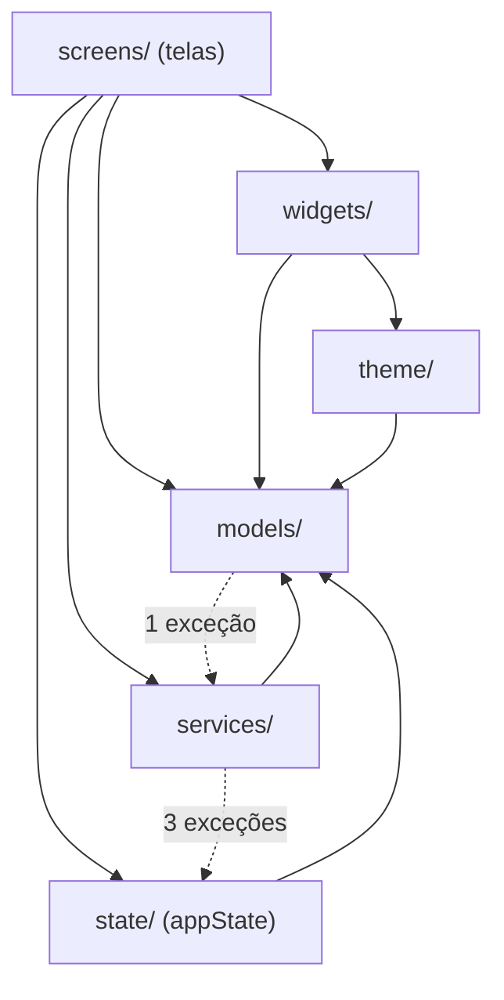

# Arquitetura do app

Um resumo de como o código do ChordAI está montado, pra achar qualquer coisa rápido.

## As camadas

O `lib/` tem seis pastas, e cada uma tem um papel:

| Pasta | O que tem | Exemplos |
|---|---|---|
| `models/` | dados e regras puras, sem tela e sem microfone | `ChordPrediction`, `ChordRepeatGate`, `UserSong`, `TuningPreset` |
| `services/` | quem fala com o mundo de fora: microfone, modelo, som, arquivos salvos | `OnDeviceChordService`, `TunerService`, `AppSounds`, `UserSongStore` |
| `state/` | o estado que vale pro app inteiro (`appState`) | acordes aprendidos, tema, modelo escolhido, preferências |
| `theme/` | cores, fontes e o jeito de cada plataforma | `platform_style.dart`, `windows_style.dart`, `mac_style.dart` |
| `widgets/` | pedaços de tela usados em mais de um lugar | `GuitarNeck`, `IosPage`, `Metronome`, `DesktopShell` |
| `screens/` | as telas | `HomeScreen`, `TunerScreen`, `LyricPlayerScreen` |

A regra que eu sigo: quem está embaixo não conhece quem está em cima. `models` não importa ninguém do app, `services` usa `models`, e as telas juntam tudo.

Onde a regra não é seguida:

- `models/user_song.dart` importa `services/cifra_parser.dart`, pra montar a música a partir do texto da cifra. O certo seria o parser morar em `models/`, porque ele não fala com nada de fora.
- Três services leem o `appState`: `chord_recognizer_factory.dart` (qual modelo usar), `app_sounds.dart` (se os sons estão ligados) e `audio_input.dart` (qual entrada de áudio foi escolhida). Funciona, mas prende esses services ao estado global.
- Dois arquivos de `models/` importam o Flutter: `theme_options.dart` (usa `Color`) e `chord_model_info.dart` (lê o arquivo do modelo pelos assets).
- `widgets/metronome.dart` chama o `AppSounds` direto, e `audio_input_section.dart` e `practice_options_sheet.dart` leem o `appState`.
- As telas importam outras telas pra navegar (a `AppShell` importa as abas, a `HomeScreen` abre o afinador). Isso é normal no Flutter.

## O reconhecimento fica separado das telas

As telas não conhecem o modelo. Elas só conhecem a interface `ChordRecognizer` (`services/chord_recognizer.dart`): pedir permissão, começar, parar, escolher a entrada de áudio e receber cada leitura (`ChordPrediction`).

- No app, quem implementa é o `OnDeviceChordService`: grava pelo `record`, guarda os últimos 1,5 s, a cada 500 ms roda o modelo TFLite e passa a leitura pelo `ChordStabilizer`. O tocar junto pede as leituras cruas (`rawReadings: true`), porque a `PlayAlongEngine` faz a conta dela.
- As telas pegam o reconhecedor pelo `createChordRecognizer()` (`chord_recognizer_factory.dart`), que usa o modelo escolhido em Reconhecimento (v3 ou v3_meu).
- Nos testes entram reconhecedores falsos (`MicQueOuve` em `test/test_helpers.dart`, `ReconhecedorFalso` em `test/tocar_junto/simulador.dart` e outros), que fingem ouvir um acorde sem carregar o modelo. Toda tela que usa o microfone recebe o `recognizer` pelo construtor só por isso.

Isso ainda é o padrão Strategy? Era, enquanto o app tinha o modo servidor: ele trocava entre o modelo no aparelho e o servidor. Depois que o modo servidor saiu ([ADR 0003](adr/0003-sem-modo-servidor.md)), só existe um reconhecedor de verdade, e a interface ficou como uma porta pros testes (injeção de dependência). Os dois modelos (v3 e v3_meu) não são duas estratégias: é o mesmo `OnDeviceChordService` carregando outro arquivo.

## Onde ficam as regras

As decisões do tipo "isso conta ou não conta" ficam em classes pequenas, sem tela, cada uma com teste próprio:

| Classe | O que decide | Onde é usada |
|---|---|---|
| `ChordStabilizer` (`services/`) | só repassa um acorde quando ele aparece em 2 das últimas 3 leituras, no máximo uma vez a cada 1,5 s | dentro do `OnDeviceChordService`: Reconhecer, treino do acorde e Sequências. O tocar junto não usa (`rawReadings: true`) |
| `ChordRepeatGate` (`models/`) | no treino do acorde, cada acerto precisa de uma batida nova; conta os acertos seguidos e zera no erro | `chord_practice_screen.dart` |
| `EchoGuard` (`models/`) | ignora as leituras logo depois de um som do app, pra ele não virar leitura | afinador (0,5 s depois do "afinado") e treino do acorde (2 s depois do "aprendido") |
| `PlayAlongEngine` (`services/`) | no tocar junto, se cada acorde da música foi acertado, errado ou não contou, com a tolerância de tempo | `lyric_player_screen.dart` |
| `PitchSmoother` (`services/`) | no afinador, segura o ponteiro, confirma a corda e diz quando ela está afinada | `TunerService` e `tuner_screen.dart` |

Quando o acorde tem 3 acertos seguidos, a tela chama `appState.registerChordHits`, que salva o acorde como aprendido (`AppState.chordMasteryHits = 3`).

## As quatro plataformas

- `theme/platform_style.dart` é o único lugar que pergunta "em que sistema eu estou": `useLiquidGlass` (iPhone e Mac), `isDesktop` (Windows e Mac), `desktopLook` (Windows 11 ou macOS) e `settingsTitle` ("Ajustes" no iPhone e no Mac, "Configurações" no Android e no Windows).
- `screens/app_shell.dart` monta a casca: no celular, as abas de baixo (Início, Acordes, Reconhecer e Afinador); no computador, entrega pro `widgets/desktop_shell.dart`, que faz a barra lateral. As telas de dentro são as mesmas.
- `services/audio_input.dart`: escolher a entrada de áudio e avisar se o microfone foi bloqueado ou desconectado. Só aparece no computador.
- `blobs/`: as bibliotecas do TensorFlow Lite pro Windows (`.dll`) e pro Mac (`.dylib`), com origem e hash em `blobs/LEIAME.md`. O celular não usa essa pasta.
- `services/app_sounds.dart`: os três sons ([docs/sons.md](sons.md)), tocados pelo `flutter_soloud`, que funciona igual nas quatro.

## Por que o estado é global

O `appState` (`state/app_state.dart`) é um único `ChangeNotifier`, criado uma vez no fim do arquivo. Ele guarda o que mais de uma tela precisa: acordes aprendidos, tema, aparência, afinação, modelo escolhido e se os sons estão ligados, e salva tudo no `shared_preferences`. O `ChordAIApp` (`main.dart`) e a `AppShell` escutam ele e redesenham quando algo muda.

Escolhi assim porque o app é pequeno, tem uma pessoa só usando e pouco estado compartilhado: um objeto global é o jeito mais curto e fácil de explicar. O que cada tela usa só pra ela (se está ouvindo, a mensagem de status, os acertos do treino) fica no `State` da própria tela.

Num app maior eu faria diferente: passaria o estado pelas telas com um `provider` (ou Riverpod) em vez de um objeto global, separaria o que é salvar no aparelho num repositório, e não deixaria services lerem o estado direto (as três exceções lá de cima). Isso deixa os testes mais fáceis, porque hoje eles precisam limpar o `appState` entre um teste e outro.

## Com que arquitetura isso se parece

Com uma arquitetura em camadas simples. Lembra o MVVM só em parte: o `appState` faz o papel de um ViewModel compartilhado (a tela escuta e redesenha), mas não existe um ViewModel por tela. Cada tela guarda o estado dela no `State` do widget e chama os services direto. As regras que valem a pena testar sozinhas saíram pras classes da tabela acima. Não é Clean Architecture: não tem casos de uso nem interfaces pra cada service (só o `ChordRecognizer`).

## O que aparece no app → arquivo

| No app | Arquivo | Classe |
|---|---|---|
| Aba Início | `screens/home_screen.dart` | `HomeScreen` |
| Aba Acordes (e o acorde aberto) | `screens/chord_list_screen.dart` e `screens/chord_detail_screen.dart` | `ChordListScreen`, `ChordDetailScreen` |
| Aba Reconhecer | `screens/recognize_screen.dart` | `RecognizeScreen` |
| Aba Afinador | `screens/tuner_screen.dart` | `TunerScreen` |
| Escolher a afinação | `screens/tuning_select_sheet.dart` | `showTuningSelectSheet` |
| Afinação personalizada | `screens/custom_tuning_screen.dart` | `CustomTuningScreen` |
| Ajustes / Configurações | `screens/settings_screen.dart` | `SettingsScreen` (e `PreferencesSection`) |
| Reconhecimento (modelo e entrada de áudio) | `screens/recognition_settings_screen.dart` | `RecognitionSettingsScreen` |
| Treino do acorde ("Testar Em") | `screens/chord_practice_screen.dart` | `ChordPracticeScreen` |
| Sequências de acordes | `screens/practice_session_screen.dart` | `PracticeSessionScreen` |
| Músicas (a lista) | `screens/lyric_sheet_list_screen.dart` | `LyricSheetListScreen` |
| Tocar junto | `screens/lyric_player_screen.dart` | `LyricPlayerScreen` |
| Editor de música | `screens/song_editor_screen.dart` | `SongEditorScreen` |
| Resumo no fim da música (relatório) | `screens/lyric_player_screen.dart` (`_showSummaryDialog`) e `models/play_along_report.dart` | `LyricPlayerScreen` |
| Guia do iniciante (lista e tópico) | `screens/guide_list_screen.dart` e `screens/guide_detail_screen.dart` | `GuideListScreen`, `GuideDetailScreen` |
| "Seu violão está afinado?" | `screens/tuning_check_screen.dart` | `TuningCheckScreen` |
| Privacidade | `screens/privacy_screen.dart` | `PrivacyScreen` |
| Primeira abertura | `screens/onboarding_screen.dart` | `OnboardingScreen` |
| Abas do celular e barra lateral | `screens/app_shell.dart` e `widgets/desktop_shell.dart` | `AppShell`, `DesktopShell` |

## O que eu arrumaria depois da entrega

O nome `lyric_*` não bate mais com o que o código faz, e o `page_parts.dart` ficou grande demais:

| Hoje | O problema | Sugestão | Por que não agora |
|---|---|---|---|
| `lyric_*` (`LyricSheet`, `LyricPlayerScreen`, `LyricSheetListScreen`, `LyricSheetLibrary`, `LyricPracticeMap`) | "lyric" é letra, e o app não tem mais letra | `song_*` (`SongSheet`, `PlayAlongScreen`, `SongListScreen`...) | não é só o nome dos arquivos: o "lyric" está no leitor de cifras (`LyricLine`, `LyricSection`, `lyricText`), em uns 30 arquivos entre `lib/` e `test/`, nos assets (`assets/lyrics/`) e numa preferência salva no aparelho (`app_lyric_font_scale`), que não pode mudar de nome sem migrar |
| `widgets/page_parts.dart` | 24 classes num arquivo só (`IosPage`, `GroupedSection`, `BottomActionBar`...) | separar em `page.dart`, `grouped_section.dart` e `buttons.dart` | 26 arquivos importam ele, e não ajuda a achar nada que a tabela de cima não ache |
