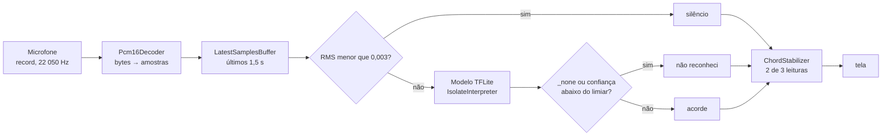
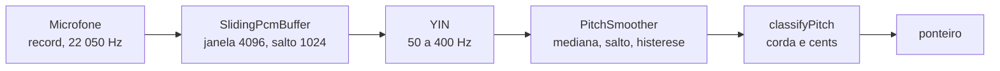
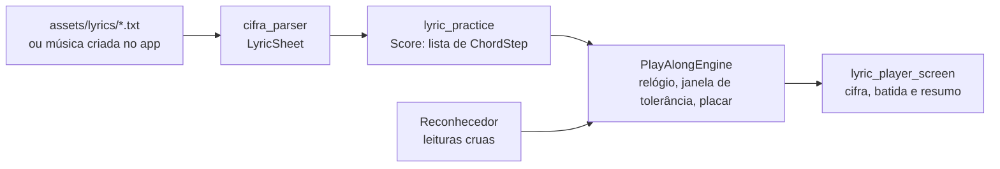

# Como o app funciona

Este documento descreve o caminho do som até a tela, em cada parte do app que usa o microfone. Cada passo traz o que faz, o motivo da escolha, o arquivo e o teste que cobre. Os números vêm do código, e cada um indica o arquivo de origem. A organização do código em pastas está em [docs/arquitetura.md](arquitetura.md).

## 1. Reconhecer acordes



| Passo | O que faz | Arquivo | Teste |
|---|---|---|---|
| Gravar | pede o áudio ao microfone em PCM de 16 bits, mono, a 22 050 Hz | `services/on_device_chord_service.dart` (`start`), com o pacote `record` | `test/segundo_plano_test.dart` e `test/abas_test.dart` (com microfone falso: o microfone desliga escondido e fora da aba) |
| Decodificar | junta os bytes em amostras de −1 a 1, guardando o byte que sobra de um bloco para o outro | `services/pcm16_decoder.dart` | `test/pcm16_decoder_test.dart` |
| Guardar a janela | um buffer circular com as últimas 33 075 amostras, que são 1,5 s | `services/latest_samples_buffer.dart` | `test/latest_samples_buffer_test.dart` |
| Rodar a cada 0,5 s | um `Timer` de 500 ms chama a inferência, se a anterior já terminou | `services/on_device_chord_service.dart` (`_tick`) | sem teste direto: precisa da biblioteca nativa do TFLite, então só o teste de equivalência no aparelho passa por aqui |
| Silêncio | se o RMS da janela for menor que `silence_rms_threshold` (0,003), nem chama o modelo | `_tick`, com o limiar do `model_info.json` | o mesmo: só no aparelho |
| Modelo | o `.tflite` recebe o áudio bruto e devolve uma probabilidade por classe. Roda num `IsolateInterpreter`, fora da thread da interface | `_infer` | `integration_test/chord_model_equivalence_test.dart` |
| Decisão | a classe de maior probabilidade. Se for `_none`, ou a confiança ficar abaixo do limiar do modelo, vira "não reconheci" | `_infer` | o mesmo teste de equivalência |
| Estabilizar | só repassa um acorde que saiu igual em 2 das últimas 3 leituras, no máximo uma vez a cada 1,5 s | `services/chord_stabilizer.dart` | `test/chord_stabilizer_test.dart` |

Por que cada escolha:

- O app manda áudio bruto. A chroma (quanto de cada uma das 12 notas há na janela) está dentro do `.tflite`, então o app não calcula FFT nem MFCC em Dart. Por que isso e por que o modelo roda no aparelho: [ADR 0001](adr/0001-inferencia-no-aparelho.md).
- Janela de 1,5 s. É o tamanho que o modelo foi treinado para olhar (`input_samples` no `model_info.json`: 33 075 amostras a 22 050 Hz).
- Fora da thread da interface. Rodar o modelo na thread da interface seguraria o desenho da tela enquanto ele calcula. O tempo no computador é de 8,78 ms por janela (`export_report.json` do backend, `latency_ms_tflite_1thread`); no celular ainda não foi medido (seção 7.2).
- O estabilizador existe porque a leitura isolada erra. Uma leitura errada no meio de duas certas não deveria virar um erro na tela. Com 2 de 3, ela é ignorada. O custo é a demora: depois de um silêncio, o acorde só aparece com três leituras (1,5 s), e trocando de um acorde para outro, com duas leituras iguais (1 s).
- O tocar junto não usa o estabilizador. Ele pede as leituras cruas (`rawReadings: true` em `services/chord_recognizer_factory.dart`), porque a `PlayAlongEngine` faz a conta dela (seção 3).
- Sem internet. O app não pede permissão de internet. O modo servidor saiu do app: [ADR 0003](adr/0003-sem-modo-servidor.md).

O que o app não faz

- Não reconhece acorde fora dos que o modelo conhece (8 no v3 e 9 no v3_meu, seção 5).
- Reconhece um acorde por janela de 1,5 s. Dois acordes dentro da mesma janela viram uma leitura só.

## 2. Afinador



| Passo | O que faz | Arquivo | Teste |
|---|---|---|---|
| Janela deslizante | janela de 4096 amostras (186 ms) que avança 1024 amostras (46 ms) por vez: cada leitura reaproveita 75% da anterior | `services/sliding_pcm_buffer.dart`, `services/tuner_service.dart` | `test/sliding_pcm_buffer_test.dart` |
| YIN | acha a frequência da nota na janela, entre 50 e 400 Hz. Janela com RMS abaixo de 0,01 não tem nota | `services/pitch_detector.dart` | `test/pitch_detector_test.dart` (senoides nas 6 cordas com erro abaixo de 1 cent) e `test/recorded_strings_test.dart` (gravações reais das 6 cordas em `test/fixtures/strings/`) |
| Suavizar | mediana das últimas 5 leituras, descarta salto de mais de 100 cents até a corda nova se confirmar em 3 leituras, e segura o ponteiro por até 3 s depois que a nota acaba | `services/pitch_smoother.dart` | `test/pitch_smoother_test.dart`, `test/afinador_gravacoes_test.dart` |
| "Afinada" | entra em "afinada" com no máximo 3 cents de erro e só sai com mais de 6 (histerese, para não piscar) | `pitch_smoother.dart` (`tuneInCents`, `tuneOutCents`) | `test/pitch_smoother_test.dart` |
| Corda e cents | compara a frequência com as cordas da afinação escolhida e calcula quantos cents faltam | `models/tuner_note.dart` (`classifyPitch`, `classifyPitchFor`) | `test/tuner_note_test.dart`, `test/afinador_tela_test.dart` |

Por que cada escolha:

- YIN. O erro mais comum num violão é a oitava: um harmônico forte faz a nota parecer uma oitava acima. O YIN olha a repetição do sinal no tempo, e o `test/pitch_detector_test.dart` confere esse caso (harmônicos pares fortes, E2 e E4). Mesmo assim ele erra a oitava no ataque da nota, então o `PitchSmoother` ignora as primeiras leituras de cada ataque.
- Faixa de 50 a 400 Hz. Cobre da 6ª corda (E2, ~82 Hz) até a 1ª (E4, ~330 Hz). Os sons do app ficam acima de 1 kHz, para não serem lidos como corda ([docs/sons.md](sons.md)).
- Histerese. Com um limite só, a nota perto do ponto certo ficaria entrando e saindo de "afinada".

## 3. Tocar junto



| Passo | O que faz | Arquivo | Teste |
|---|---|---|---|
| Ler a cifra | transforma o texto (tom, tempo, batida, partes e acordes) numa `LyricSheet`. Uma linha que não é só de acordes vira texto, e o teste quebra se uma letra entrar | `services/cifra_parser.dart` | `test/cifra_parser_test.dart`, `test/chord_beats_test.dart`, `test/cifras_sem_letra_test.dart` |
| Montar a sequência | achata as partes numa lista de acordes com a duração em tempos (`ChordStep`) e guarda onde cada um está na tela | `models/lyric_practice.dart`, `models/score.dart` | `test/lyric_practice_test.dart` |
| Traduzir para o modelo | troca o acorde da cifra pelo que o modelo conhece: tira o baixo (C/G vira C), reduz extensão (Am7 vira Am), troca enarmonia (A# vira Bb). O que não dá (D no v3, sus, aug) fica "não conta" | `models/chord_for_model.dart` | `test/chord_for_model_test.dart` |
| Andar no tempo | o relógio mede o tempo em batidas, com 4 batidas de contagem antes de começar | `services/play_along_engine.dart` | `test/tocar_junto_tela_test.dart` |
| Conferir | cada acorde recebe as leituras que chegam na janela dele e é julgado quando a janela fecha | `PlayAlongEngine.reading` e `_judge` | `test/tocar_junto_test.dart` |

As regras da `PlayAlongEngine` (constantes em `services/play_along_engine.dart`):

- Contagem: 4 batidas (`countInBeats`).
- Tolerância: uma leitura vale para o acorde se chegar até 300 ms antes (`earlyTolerance`) ou até 1000 ms depois (`lateTolerance`) da janela dele.
- Acorde curto: um acorde que dura menos de 1000 ms (`shortestCounted`) não conta. O app diz "passa rápido demais pra eu ouvir", porque o modelo decide em janelas de 1,5 s.
- Acertar: acorde de 2 s ou mais precisa de 2 leituras certas (`readingsToHitLongChord`); os mais curtos, de 1.
- Dois jeitos: "acompanhar o andamento" (a cifra anda sozinha e o acorde é julgado ao fim da janela) e "esperar por mim" (a cifra espera o acorde ser tocado, e só segue quando ele sai, ou quando passa o dobro do tempo do acorde mais a tolerância).
- Sem microfone: com "Ouvir pelo microfone" desligado em Aa, a cifra anda no tempo e nada é conferido (`lib/screens/lyric_player_screen.dart`, `_withMic`; `test/musicas_test.dart`).

Os números da simulação vêm de `test/tocar_junto_test.dart`, que toca as cifras com um modelo falso (`test/tocar_junto/simulador.dart`) e confere o placar. Eles vêm de simulação, e não de um violão de verdade:

| Cenário | Certos | Errados |
|---|---:|---:|
| Riptide, tocado certinho | 88 | 0 |
| Riptide, tudo 0,8 s atrasado (dentro dos 1000 ms) | 88 | 0 |
| Riptide, o modelo não ouve o G | 59 | 29 |
| Riptide, três acordes errados de propósito | 85 | 3 |
| Riptide, silêncio do começo ao fim | 0 | 88 |
| All Too Well, tocado certinho | 243 | 0 |

O que o tocar junto não faz. O modelo decide em janelas de 1,5 s: dois acordes que trocam dentro da mesma janela, como uma troca a cada 1 s, não dão leitura limpa. Por isso a regra do acorde curto. A tolerância de 1000 ms é uma escolha de projeto, ainda sem medida: o valor que serve num violão de verdade fica como trabalho futuro, com o método da seção 7.3.

## 4. Desktop (Windows e Mac)

- O mesmo modelo, o mesmo pacote. O app usa o `tflite_flutter` 0.12.1 nas quatro plataformas. No iPhone e no Android ele já traz o motor do TensorFlow Lite. No Windows e no Mac, o pacote manda trazer a biblioteca nativa, e ela vem de `blobs/` (`libtensorflowlite_c-win.dll` e `libtensorflowlite_c-mac.dylib`, com origem e hash em `blobs/LEIAME.md`).
- Por que o app não usa o `flutter_litert`. Só os arquivos dele foram aproveitados. Trocar de pacote trocaria o motor do celular também, e o que já funciona no celular não podia mudar por causa do desktop (`blobs/LEIAME.md`).
- Equivalência. O mesmo teste do celular confere a saída do modelo contra a esperada pelo backend (`integration_test/chord_model_equivalence_test.dart`), e passou no Windows e no Mac.
- Entrada de áudio. Só no Windows e no Mac dá para escolher o microfone, porque é comum ter interface, webcam ou pedaleira. O app guarda o id escolhido e usa a entrada padrão se ela sumir (`services/audio_input.dart`, `test/entrada_audio_test.dart`). Se o microfone for bloqueado pelo sistema ou a entrada for desconectada, ele avisa e para (`test/microfone_desktop_test.dart`).
- Layout próprio. `theme/platform_style.dart` decide: `isDesktop` (Windows e Mac) troca as abas de baixo pela barra lateral (`widgets/desktop_shell.dart`), e `desktopLook` escolhe o jeito de Windows 11 ou de macOS. `useLiquidGlass` (iPhone e Mac) liga o vidro. As telas de dentro são as mesmas (`test/desktop_test.dart`, `test/layout_sizes_test.dart`).

## 5. Os dois modelos

O app traz dois modelos em `assets/models/`:

| | v3 (padrão) | v3_meu |
|---|---|---|
| Pasta | `assets/models/v3/` | `assets/models/v3_meu/` |
| Acordes | 8 (Am, Bb, Bdim, C, Dm, Em, F e G) | 9 (os 8 + A) |
| Limiar de confiança | 0,50 | 0,55 |
| Seed | 44 | 43 |

Fonte: o `model_info.json` e o `labels.json` de cada pasta. Por que são dois e por que o v3 é o padrão: [ADR 0002](adr/0002-dois-modelos-no-app.md).

- Como o app escolhe. O enum `OnDeviceModel` (`models/on_device_model.dart`) diz a pasta de cada modelo. O `OnDeviceChordService` pergunta a `appState.onDeviceModel` a cada início e, se o modelo mudou, descarrega o antigo e carrega o novo.
- De onde vem a lista de acordes. Do `labels.json` do modelo, menos a classe `_none` (`models/chord_model_info.dart`, `chords`). O `appState.chordsInModel` guarda essa lista, e é por ela que o app mostra o A só quando o v3_meu está escolhido.
- De onde vem o limiar. Do `confidence_threshold` do `model_info.json`. Nada fica fixo no código do app.
- Que os arquivos são os certos. O `model_info.json` guarda o sha256 de cada `.tflite`. `tool/conferir_modelos.py` compara os dois, e o CI roda esse script em todo push.
- Onde se escolhe. Em Ajustes → Reconhecimento (Configurações no Android e no Windows).
- Testes: `test/on_device_model_test.dart`, `test/chord_catalog_test.dart`.

## 6. O que fica salvo no aparelho

O estado do app é um objeto só, o `appState` (`state/app_state.dart`), que guarda tudo no `shared_preferences`. O app não guarda nenhum dado pessoal e não manda nada para lugar nenhum ([PRIVACY.md](../PRIVACY.md)).

| Chave | O que guarda |
|---|---|
| `app_learned_chords` | os acordes aprendidos |
| `app_guide_read` | os tópicos do guia já abertos |
| `app_has_onboarded`, `app_always_onboarding` | se a apresentação já foi vista, e se ela deve aparecer toda vez |
| `app_selected_theme`, `app_appearance` | a cor do app e a aparência (papel, branco, escuro ou igual ao celular) |
| `app_tuning_id`, `app_custom_tuning` | a afinação escolhida e a personalizada |
| `app_on_device_model` | o modelo escolhido (v3 ou v3_meu) |
| `app_input_device_id` | a entrada de áudio escolhida (só Windows e Mac) |
| `app_lyric_font_scale`, `app_strum_arrow_scale`, `app_show_guitar_neck`, `app_auto_scroll` | a leitura das cifras |
| `app_play_along_waits_for_me`, `app_play_along_listens`, `app_song_bpm` | o jeito de tocar junto, se ouve pelo microfone e o BPM de cada música |
| `app_sounds`, `app_metronome_sound` | os sons e o clique do metrônomo |
| as músicas criadas no app | `services/user_song_store.dart`, também no `shared_preferences` |

- Chaves que saíram. Na primeira vez que o app abre, ele apaga as chaves do modo servidor (`_oldServerKeys`) e as do perfil e dos números de prática (`_removedKeys`). Teste: `test/recognition_mode_migration_test.dart` e `test/settings_test.dart`.
- O que não é salvo. O áudio nunca é gravado em arquivo: a janela de 1,5 s vive na memória e é sobrescrita (`LatestSamplesBuffer`).

## 7. Como medir a demora

Dois números ainda não foram medidos, porque dependem do aparelho e do violão usados. O método fica aqui como trabalho futuro.

### 7.1 Do acorde tocado até aparecer na tela

Demora medida: ainda não foi medida.

Como medir, com dois aparelhos:

1. Ponha o app no iPhone, na tela Reconhecer, com o v3.
2. Com um segundo celular em câmera lenta (240 quadros por segundo), filme a tela do iPhone e o violão ao mesmo tempo.
3. Toque um acorde, uma batida só, com o violão perto do microfone.
4. No vídeo, passe quadro a quadro (no Fotos do iPhone ou no QuickTime do Mac). Conte os quadros entre a palheta tocando a corda e o nome do acorde aparecendo.
5. Demora em ms = quadros ÷ 240 × 1000. Repita umas 10 vezes e anote a média e o maior valor.

Esperado pelo código: as leituras saem a cada 500 ms, e o acorde só aparece com duas leituras iguais (1 s) ou, depois de um silêncio, com três (1,5 s) (seção 1). Então o valor medido não deve ficar abaixo de 1 s.

### 7.2 O tempo de cada leitura do modelo

Hoje o app guarda `lastInferenceMicros` (`on_device_chord_service.dart`) só no registro de debug, e nenhum arquivo do repositório guarda o tempo no celular. O ADR 0001 diz que no celular a medida ainda não foi feita, e o único número salvo é o do computador: 8,78 ms no float32 com 1 thread (`export_report.json` do backend, `latency_ms_tflite_1thread`).

Como medir no iPhone, para cada modelo:

1. Com o iPhone no cabo: `flutter run -d <id-do-iphone>` (modo debug, sem `--release`).
2. Em Ajustes → Reconhecimento, escolha o modelo, abra a tela Reconhecer e toque um acorde por uns 20 segundos.
3. Salve o registro: `flutter run -d <id-do-iphone> | tee leituras.log`.
4. Tire a média e o maior valor:

```bash
grep -o 'inferencia_us=[0-9]*' leituras.log | cut -d= -f2 | awk '{s+=$1; n++; if ($1>m) m=$1} END {print n " leituras, média " s/n/1000 " ms, maior " m/1000 " ms"}'
```

5. Repita com o outro modelo e salve o resultado num arquivo do repositório (sugestão: `docs/latencia.md`, com o aparelho, o modelo, a quantidade de leituras, a média e o maior valor). O README só pode citar um número depois disso.

Em debug o app é mais lento que em release. Anote isso junto, ou meça com `flutter run --profile`.

### 7.3 A tolerância do tocar junto

Esta medida ainda não foi feita. Para saber se a `lateTolerance` de 1000 ms (`services/play_along_engine.dart`) está boa, mede-se quanto tempo a leitura certa demora depois da troca de acorde.

1. Rode o tocar junto no iPhone em debug, com `flutter run -d <id-do-iphone> | tee tj.log` (o registro `[tj]` só existe em debug).
2. Toque a música em "Acompanhar o andamento", trocando de acorde junto com a cifra.
3. Para cada ataque do violão, calcule o tempo até a primeira leitura com acorde:

```bash
sed -n 's/.*\[tj\] //p' tj.log | awk '$2=="ataque"{t=$1; w=1} $2=="tela_recebeu" && $3=="ok" && w {print $1-t; w=0}' | sort -n | awk '{v[NR]=$1; s+=$1} END {print NR " trocas, média " s/NR " ms, mediana " v[int((NR+1)/2)] " ms, maior " v[NR] " ms"}'
```

4. Compare com o que o código espera: a leitura chega até 1000 ms depois do fim da janela do acorde. Se a média e o maior valor ficarem bem abaixo de 1000 ms, a tolerância está boa. Se o maior passar de 1000 ms, as trocas lentas são contadas como erro, e o valor medido é o que deve embasar a decisão de mudar a constante. A constante não muda sem essa decisão.
