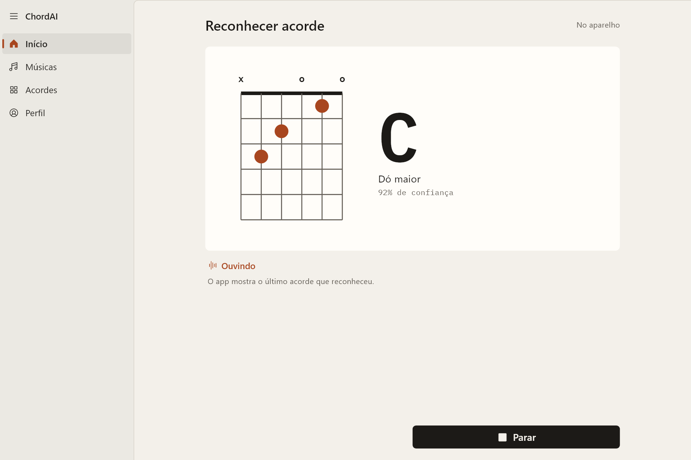

# ChordAI no computador

No celular o app tem barra de abas embaixo e tudo pensado pro dedo. No Windows e no Mac ele usa as
mesmas telas, com a mesma lógica, mas com a casca de um programa de computador. Nada disso aparece
no iPhone nem no Android: tudo passa por `isDesktop`, em `lib/theme/platform_style.dart`.



## O que muda no computador

- **Barra lateral** no lugar das abas de baixo (`lib/widgets/desktop_shell.dart`), com as mesmas
  quatro abas. Cada aba tem a própria pilha de telas: abrindo um acorde ou uma música, a barra
  continua do lado. Abaixo de 1000 px de largura a barra recolhe pra só os ícones, e o ☰ abre e
  fecha.
- **"Entrada de áudio"** no pé da barra, porque no computador é comum trocar de microfone
  (interface, webcam, pedaleira). A lista também está em Perfil → Reconhecimento.
- **Só o modelo no aparelho.** O computador roda o modelo sem esforço, então o modo servidor não
  aparece. Se ele ficou salvo de antes, o computador ignora.
- **Cabeçalho** com o título grande à esquerda e o botão de voltar, e a coluna de leitura com até 720
  px (no celular são 600).
- **Duas colunas** onde ajuda:
  - Acordes: a lista de um lado e o acorde aberto do outro.
  - Tocar junto: a cifra de um lado e o painel (acorde, próximo, BPM e Começar) do outro.
  - No Reconhecer o braço e o nome do acorde ficam bem maiores, pra ver de longe.
- **Mouse e teclado** (`lib/widgets/desktop_input.dart`):
  - Realce ao passar o mouse e cursor de mão no que dá pra clicar.
  - Espaço começa e para a prática e o tocar junto.
  - Esc volta uma tela.
  - As bandejas que sobem de baixo viram diálogo no meio da janela.
- **Botão de baixo** compacto, à direita, em vez da pílula na largura toda.

## A cara do Windows 11

Fica em `lib/theme/windows_style.dart` e só vale quando `desktopLook` é `windows`. Não usei
nenhum pacote novo:

- Fonte Segoe UI Variable (cai pra Segoe UI no Windows 10).
- Barra lateral um tom mais escura e o conteúdo numa "folha" com o canto de cima arredondado,
  como o NavigationView. Os itens têm as medidas dele: pílula de 36 px, cantos de 4 e a barrinha
  da cor do app dentro dela.
- Cantos de 8 nos cards, contorno fino e, no escuro, cinza (#202020) em vez do preto do iPhone.
- Botões retangulares de 36 px, com canto de 6.
- Troca de tela suave: a tela nova sobe um pouco enquanto aparece.
- A barra de título fica com a cor do app, inclusive no escuro. Quem pinta é o runner em C++
  (`windows/runner/flutter_window.cpp`, canal `chordai/window`), porque o Flutter não desenha essa
  barra. O ícone e o texto dela ficam escondidos, e o "☰ ChordAI" da barra lateral faz esse papel.

O que eu deixei de fora: o fundo Mica de verdade e uma barra de título própria. Os pacotes pra isso
(`flutter_acrylic` e `window_manager`) são antigos ou pedem o Flutter 3.50, e o projeto está no
3.47.1.

## Como eu sei que o celular não mudou

- `test/layout_sizes_test.dart` roda as telas nos quatro tamanhos de celular de antes e também na
  janela inicial (1200 × 800) e na mínima (800 × 560) do Windows.
- `test/desktop_test.dart` confere a barra lateral no Windows e a barra de abas no celular.
- Comparei pixel a pixel 18 telas no iPhone e 18 no Android, renderizadas a partir da master e da
  branch do layout de computador: ficaram iguais.

## Pra sessão do Mac

O Mac já usa a casca toda (barra lateral, colunas, mouse e teclado), porque `isDesktop` vale pra ele.
O que falta é a cara do Mac, e o lugar pra ela está pronto:

- `desktopLook` (em `platform_style.dart`) já devolve `DesktopLook.mac` no macOS. É o único ponto
  que escolhe o estilo por plataforma no computador.
- Hoje o Mac cai no estilo comum: barra lateral sem a "folha" do Windows, cantos e fontes do
  celular e a transição do Cupertino. Cada lugar que testa `DesktopLook.windows` é onde o Mac pode
  ganhar o seu caso:
  - `windows_style.dart`: fonte, cor da barra lateral, troca de tela.
  - `glass_tokens.dart`: cantos.
  - `app_theme.dart`: botões, escuro, transição.
  - `desktop_shell.dart`: a folha de conteúdo e o fundo da barra.
  - `page_parts.dart`: contorno dos cards e painel flutuante.
- No Mac o `useLiquidGlass` é verdadeiro, mas a barra de abas de vidro não aparece no computador:
  a barra lateral entra no lugar. Os diálogos e painéis no Mac ainda usam o Material.
- A barra de título do Mac é do macOS e não tem o canal `chordai/window` (esse é só do Windows).

## Imagens

As imagens em `docs/imagens/` saem de `test/imagens_docs_test.dart`, com a fonte Segoe UI de
verdade. Como precisa dela, só roda num Windows:

```
flutter test test/imagens_docs_test.dart --update-goldens --dart-define=IMAGENS=true
```
